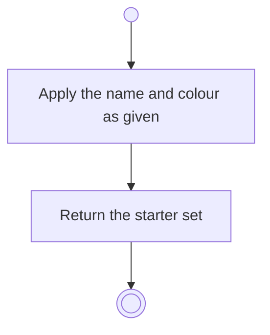

# BP01.03 — Amend a starter theme

> GENERATED by `bpmn-dsl si-export` — do not edit; the source is the `call` block in the
> `.bpd` (#1182/ADR-068, keyed by call site per ADR-069).
>
> hash: `sha256:9954da85d938438158e00281844c37a4b3b2a23031401ea9a0d070dbf9262576`

## BP01_StartBearing — Activity diagram

### Messages

| Where | Message | To | Payload |
|---|---|---|---|
| Amend a starter theme | Starter set updated | User | — |

### Notes

- **Amend a starter theme**: Editing, removing and adding are three operations, not three variations of one, so the wizard's inline edits are three call sites.
