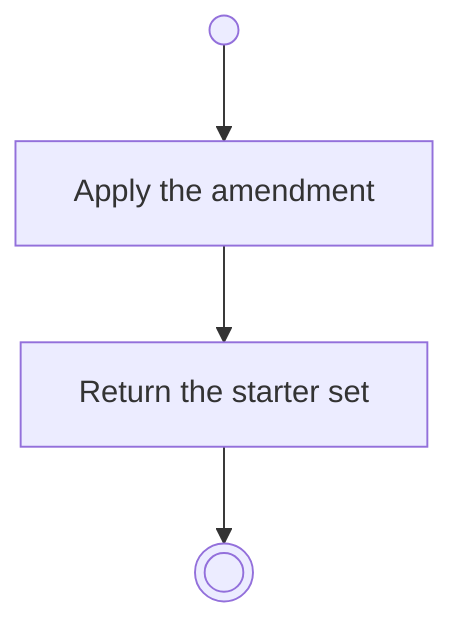

# BP01.03 — Amend the starter set

> GENERATED by `bpmn-dsl si-export` — do not edit; the source is the `call` block in the
> `.bpd` (#1182/ADR-068, keyed by call site per ADR-069).
>
> hash: `sha256:b767aefca48dd7951ebdb0ca48237459109bb046acf665589e771f3f14159ae2`

## BP01_StartBearing — Activity diagram

### Messages

| Where | Message | To | Payload |
|---|---|---|---|
| Amend the starter set | Starter set updated | User | — |
