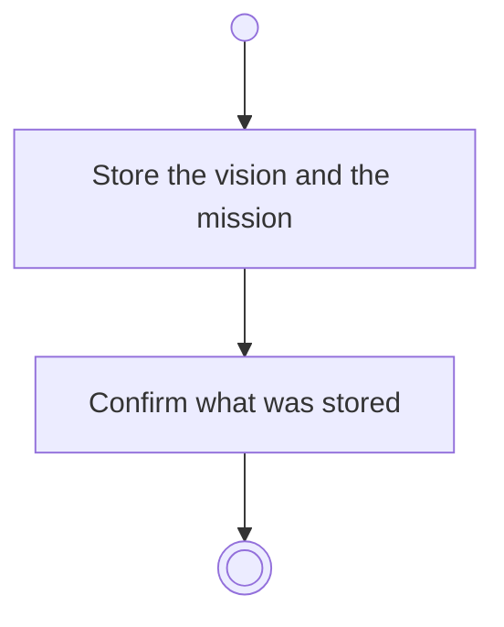

# BP01.04 — Record vision and mission

> GENERATED by `bpmn-dsl si-export` — do not edit; the source is the `call` block in the
> `.bpd` (#1182/ADR-068, keyed by call site per ADR-069).
>
> hash: `sha256:7bd6590204351919231f9c2ba8827097eb2ac590c42d3973f4fe7e2f91530854`

## BP01_StartBearing — Activity diagram

### Messages

| Where | Message | To | Payload |
|---|---|---|---|
| Record vision and mission | Vision and mission recorded | User | — |
