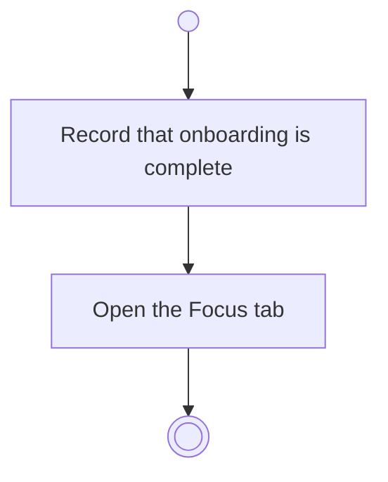

# BP01.05 — Complete onboarding

> GENERATED by `bpmn-dsl si-export` — do not edit; the source is the `call` block in the
> `.bpd` (#1182/ADR-068, keyed by call site per ADR-069).
>
> hash: `sha256:d19419f400e44c6400da78603cf8a886664f9830576d6c236e7ff247060a87d8`

## BP01_StartBearing — Activity diagram

### Bound rules

| Where | Rule |
|---|---|
| Open the Focus tab | `BR-48` |

### Messages

| Where | Message | To | Payload |
|---|---|---|---|
| Complete onboarding | Bearing ready on Focus | User | — |

### Notes

- **Complete onboarding**: Reached from either wizard step: skipping is the same act as completing, minus what was skipped.
