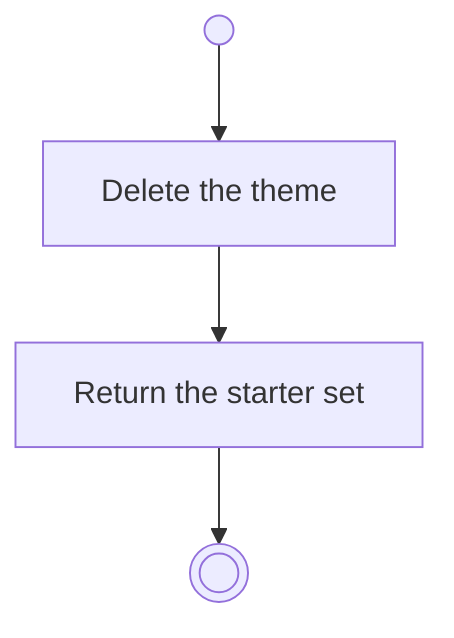

# BP01.06 — Remove a starter theme

> GENERATED by `bpmn-dsl si-export` — do not edit; the source is the `call` block in the
> `.bpd` (#1182/ADR-068, keyed by call site per ADR-069).
>
> hash: `sha256:e300a7c7a75cb48c6b2236a5cd6cb0b10bfcb91b9b7ab8f92d2c95be2ab0eafd`

## BP01_StartBearing — Activity diagram

### Messages

| Where | Message | To | Payload |
|---|---|---|---|
| Remove a starter theme | Starter set updated | User | — |
