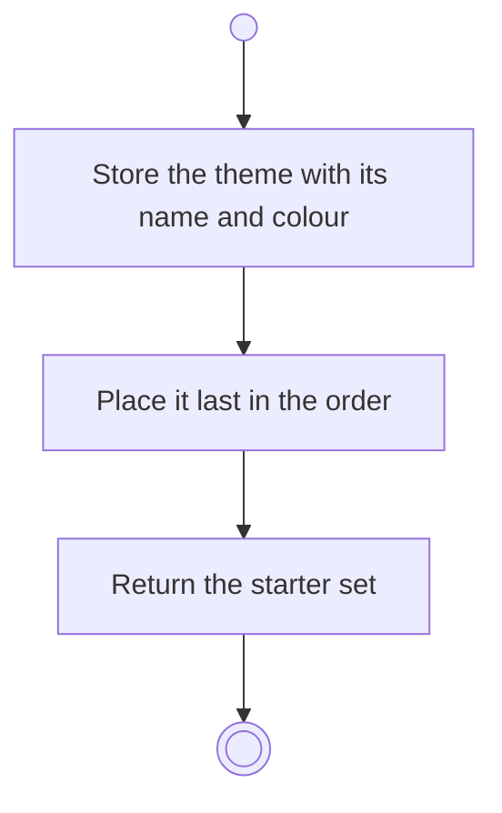

# BP01.07 — Add a theme

> GENERATED by `bpmn-dsl si-export` — do not edit; the source is the `call` block in the
> `.bpd` (#1182/ADR-068, keyed by call site per ADR-069).
>
> hash: `sha256:c65bd08ea89cf4874434f994834a74ae01a50944e804b9764fb3357d02758529`

## BP01_StartBearing — Activity diagram

### Messages

| Where | Message | To | Payload |
|---|---|---|---|
| Add a theme | Starter set updated | User | — |
