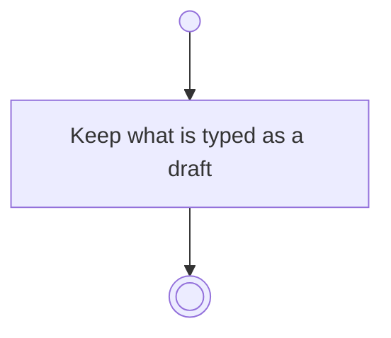

# BP01.08 — Draft the wizard input

> GENERATED by `bpmn-dsl si-export` — do not edit; the source is the `call` block in the
> `.bpd` (#1182/ADR-068, keyed by call site per ADR-069).
>
> hash: `sha256:919f494051788bbcc20729bbe4b51ae9d9592e02e2b5ec9d0e4ab821cde260fa`

## BP01_StartBearing — Activity diagram

### Bound rules

| Where | Rule |
|---|---|
| Keep what is typed as a draft | `BR-121` |

### Notes

- **Draft the wizard input**: Every form on this surface drafts as it is filled in, so leaving it half-finished, a crash and a restart all cost nothing. The draft is one-way: nothing waits for it to be kept. Whichever write commits the form discards it.
