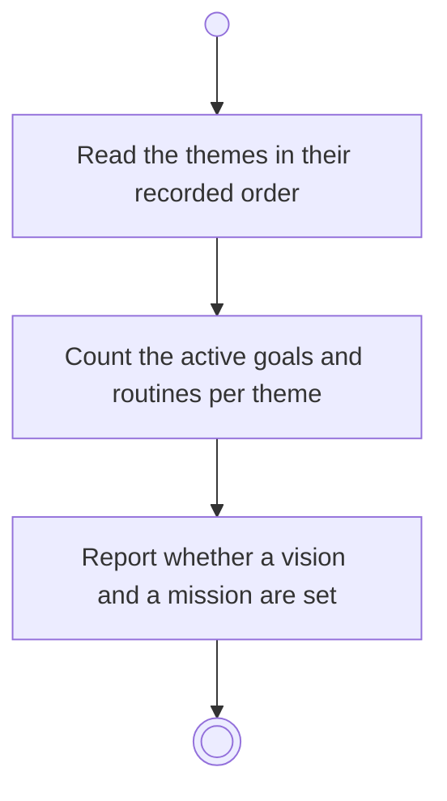

# BP02.01 — Read the themes overview

> GENERATED by `bpmn-dsl si-export` — do not edit; the source is the `call` block in the
> `.bpd` (#1182/ADR-068, keyed by call site per ADR-069).
>
> hash: `sha256:bd3f935de1b50fa489bf5fb6d850399034480ce8b68a138e2f2b411df4af71ad`

## BP02_MaintainLifeThemes — Activity diagram

### Bound rules

| Where | Rule |
|---|---|
| Count the active goals and routines per theme | `BR-95` |

### Messages

| Where | Message | To | Payload |
|---|---|---|---|
| Read the themes overview | Themes with their goal and routine counts | User | — |

### Notes

- **Read the themes overview**: Archived goals are not counted. The count states what is live under the theme today. Whether the prose is set is what distinguishes a collapsed section from one never written; the prose itself is read on expanding it.
