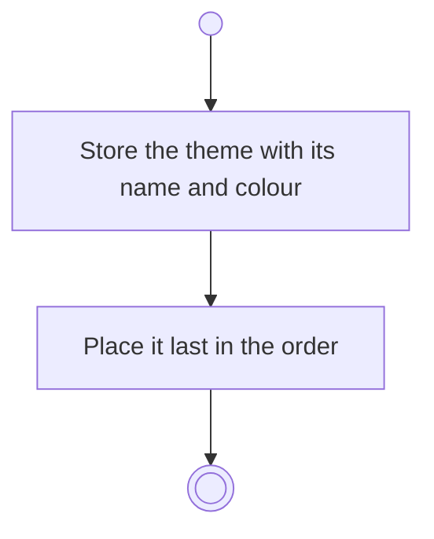

# BP02.02 — Create a theme

> GENERATED by `bpmn-dsl si-export` — do not edit; the source is the `call` block in the
> `.bpd` (#1182/ADR-068, keyed by call site per ADR-069).
>
> hash: `sha256:b73ffcff8086e797a191ae440b009b1cd8c1d2b86f47219aa3e1e8c5a6b0edee`

## BP02_MaintainLifeThemes — Activity diagram

### Messages

| Where | Message | To | Payload |
|---|---|---|---|
| Create a theme | Theme created | User | — |
