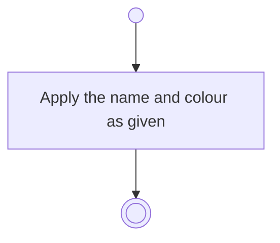

# BP02.03 — Amend a theme

> GENERATED by `bpmn-dsl si-export` — do not edit; the source is the `call` block in the
> `.bpd` (#1182/ADR-068, keyed by call site per ADR-069).
>
> hash: `sha256:63a5b9e008e3d0d27c4033e88d99ec522d1799d765c2a6086095e144621432b4`

## BP02_MaintainLifeThemes — Activity diagram

### Bound rules

| Where | Rule |
|---|---|
| Apply the name and colour as given | `BR-09` |

### Messages

| Where | Message | To | Payload |
|---|---|---|---|
| Amend a theme | Theme amended | User | — |

### Notes

- **Amend a theme**: One request covers the name, the colour or both. The colour reaches every entity under the theme.
