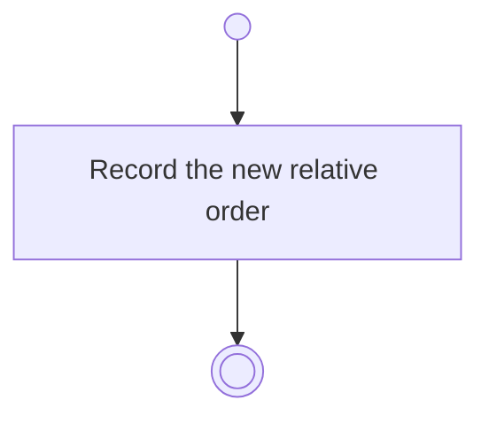

# BP02.04 — Reorder themes

> GENERATED by `bpmn-dsl si-export` — do not edit; the source is the `call` block in the
> `.bpd` (#1182/ADR-068, keyed by call site per ADR-069).
>
> hash: `sha256:93204809cc7eabfdb3a5e5cb58a09209867d720265fa8aec6f55eee2d5530c59`

## BP02_MaintainLifeThemes — Activity diagram

### Messages

| Where | Message | To | Payload |
|---|---|---|---|
| Reorder themes | Order recorded | User | — |

### Notes

- **Reorder themes**: Order is relative, so a theme's place is never a stored index.
