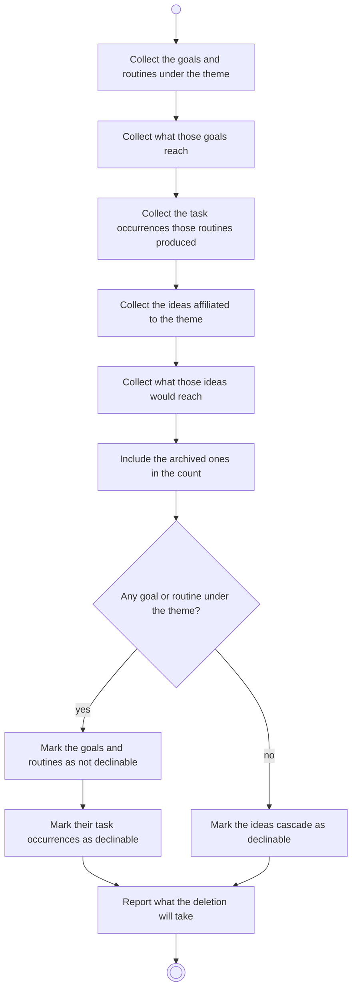

# BP02.05 — See what deleting a theme takes

> GENERATED by `bpmn-dsl si-export` — do not edit; the source is the `call` block in the
> `.bpd` (#1182/ADR-068, keyed by call site per ADR-069).
>
> hash: `sha256:a0d49b48267b56be955e4798d894ab7e0de02d21f1031f257f41d9c05309a866`

## BP02_MaintainLifeThemes — Activity diagram

### Bound rules

| Where | Rule |
|---|---|
| Collect what those goals reach | `BR-15` |
| Collect the task occurrences those routines produced | `BR-16` |
| Collect what those ideas would reach | `BR-14` |
| Include the archived ones in the count | `BR-117` |
| "Any goal or routine under the theme?" | `BR-21` |
| Mark their task occurrences as declinable | `BR-16` |
| Mark the ideas cascade as declinable | `BR-19` |

### Messages

| Where | Message | To | Payload |
|---|---|---|---|
| See what deleting a theme takes | What the deletion will take | User | — |

### Notes

- **See what deleting a theme takes**: A goal and a routine each require a theme, so keeping one is not a legal outcome: the gesture is then approve-or-abandon. An idea may stay behind theme-less, so that cascade is the one real choice and starts off. The disclosure reaches two levels down, because a deleted goal takes its projects and measures with it, and so does an included idea. An archived descendant is counted like a live one.
