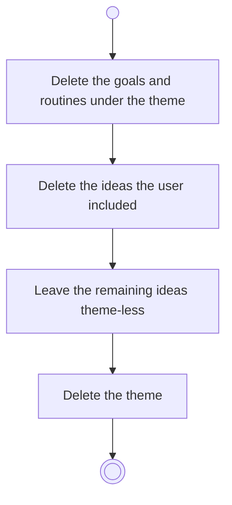

# BP02.06 — Delete a theme

> GENERATED by `bpmn-dsl si-export` — do not edit; the source is the `call` block in the
> `.bpd` (#1182/ADR-068, keyed by call site per ADR-069).
>
> hash: `sha256:b34a00d12dc2fc5424b46413a2cfbc688c2bb058f658565f353bff5b7abbee36`

## BP02_MaintainLifeThemes — Activity diagram

### Bound rules

| Where | Rule |
|---|---|
| Delete the goals and routines under the theme | `BR-13` |
| Leave the remaining ideas theme-less | `BR-03` |

### Messages

| Where | Message | To | Payload |
|---|---|---|---|
| Delete a theme | Theme deleted | User | — |

### Notes

- **Delete a theme**: The request carries the cascade the user approved. What happens below a deleted goal or idea is that entity's own rule, applied where the deletion reaches it.
