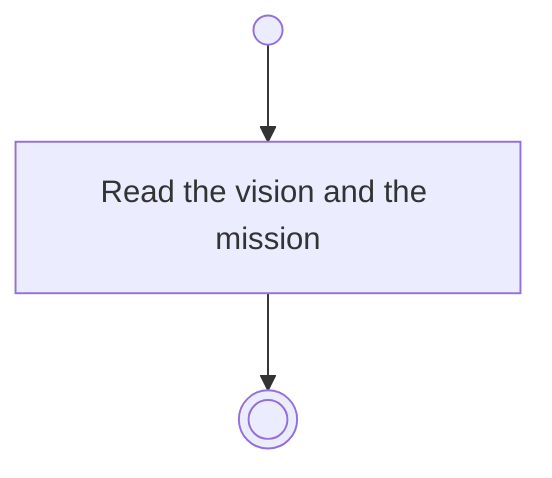

# BP02.07 — Read vision and mission

> GENERATED by `bpmn-dsl si-export` — do not edit; the source is the `call` block in the
> `.bpd` (#1182/ADR-068, keyed by call site per ADR-069).
>
> hash: `sha256:7d6f93ebdc86caa1466a55bf8b66be2da73959cedd95d2e8ae393d3201bf7120`

## BP02_MaintainLifeThemes — Activity diagram

### Messages

| Where | Message | To | Payload |
|---|---|---|---|
| Read vision and mission | Vision and mission | User | — |
