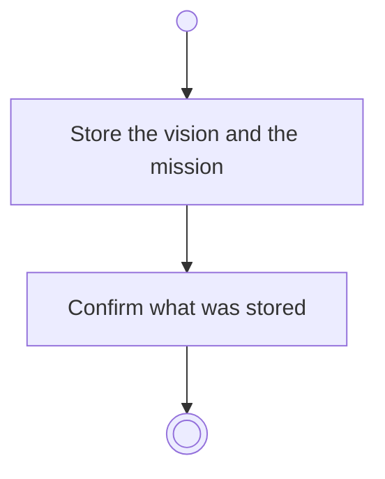

# BP02.08 — Record vision and mission

> GENERATED by `bpmn-dsl si-export` — do not edit; the source is the `call` block in the
> `.bpd` (#1182/ADR-068, keyed by call site per ADR-069).
>
> hash: `sha256:ebbfad5cc4046ef16427cd09a1e3ec2de85a1db6cc196bd71ae0a77a52bc0084`

## BP02_MaintainLifeThemes — Activity diagram

### Messages

| Where | Message | To | Payload |
|---|---|---|---|
| Record vision and mission | Vision and mission recorded | User | — |

### Notes

- **Record vision and mission**: Both fields are optional. Empty text is the unset state.
