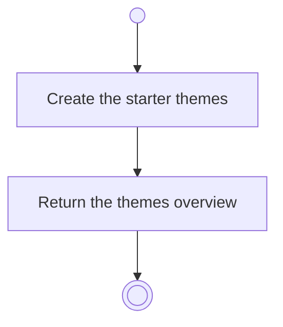

# BP02.09 — Seed the starter themes

> GENERATED by `bpmn-dsl si-export` — do not edit; the source is the `call` block in the
> `.bpd` (#1182/ADR-068, keyed by call site per ADR-069).
>
> hash: `sha256:e490c7c2d7b2e502c98a2903301ee8624946d4852a0285bcf7d9c015350fe07a`

## BP02_MaintainLifeThemes — Activity diagram

### Bound rules

| Where | Rule |
|---|---|
| Create the starter themes | `BR-83` |

### Messages

| Where | Message | To | Payload |
|---|---|---|---|
| Seed the starter themes | Starter themes | User | — |

### Notes

- **Seed the starter themes**: The only thing in the product with a default worth seeding. BP01 seeds the same set at a first run; whether the two call sites are one System Interaction is a Design finding.
