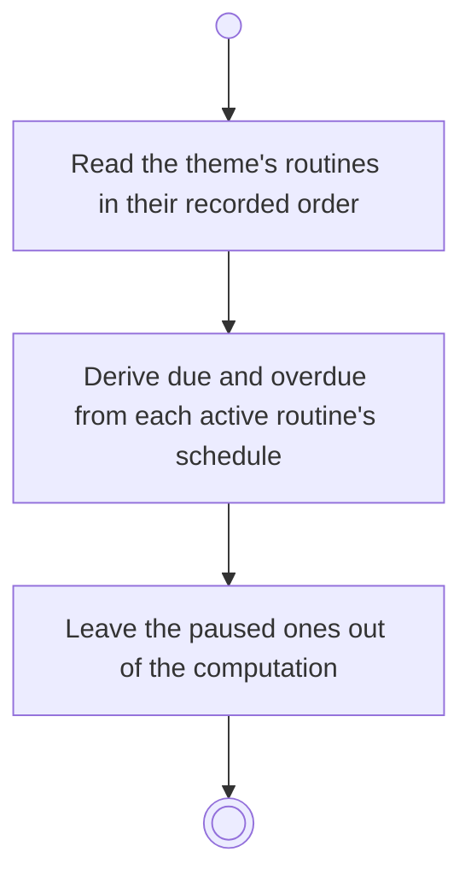

# BP03.01 — Read a theme's routines

> GENERATED by `bpmn-dsl si-export` — do not edit; the source is the `call` block in the
> `.bpd` (#1182/ADR-068, keyed by call site per ADR-069).
>
> hash: `sha256:b3848e66e7cf6e05fe8293a2aa1573d16d2ef0c3e612240f6761824e09de1993`

## BP03_MaintainRoutines — Activity diagram

### Bound rules

| Where | Rule |
|---|---|
| Derive due and overdue from each active routine's schedule | `BR-91` |
| Leave the paused ones out of the computation | `BR-43` |

### Messages

| Where | Message | To | Payload |
|---|---|---|---|
| Read a theme's routines | The theme's routines with their schedules | User | — |

### Notes

- **Read a theme's routines**: Due and overdue are computed from the recurrence and the preferred days of the active routines. A paused routine is neither, and the days it spends paused never become overdue. The computation writes nothing.
