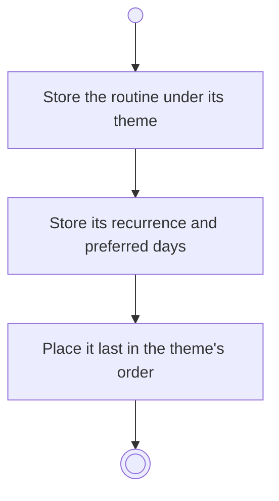

# BP03.02 — Define a routine

> GENERATED by `bpmn-dsl si-export` — do not edit; the source is the `call` block in the
> `.bpd` (#1182/ADR-068, keyed by call site per ADR-069).
>
> hash: `sha256:b2bcfbb9208377035c44dc9002b807e49aed7d5c6be78cd2341df563773f564e`

## BP03_MaintainRoutines — Activity diagram

### Bound rules

| Where | Rule |
|---|---|
| Store the routine under its theme | `BR-02` |
| Store its recurrence and preferred days | `BR-94` |

### Messages

| Where | Message | To | Payload |
|---|---|---|---|
| Define a routine | Routine defined | User | — |

### Notes

- **Define a routine**: The theme is required. The recurrence is Daily, Weekly, Monthly or Yearly.
