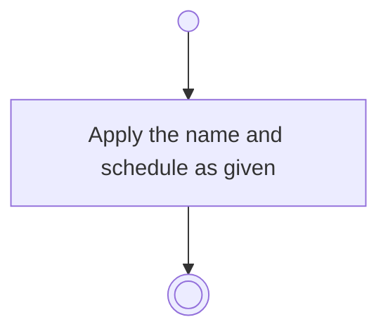

# BP03.03 — Amend a routine

> GENERATED by `bpmn-dsl si-export` — do not edit; the source is the `call` block in the
> `.bpd` (#1182/ADR-068, keyed by call site per ADR-069).
>
> hash: `sha256:97aa3617404912b0a0048f8258018e6795216377cf17c96be0c3afc90a4e2e72`

## BP03_MaintainRoutines — Activity diagram

### Bound rules

| Where | Rule |
|---|---|
| Apply the name and schedule as given | `BR-94` |

### Messages

| Where | Message | To | Payload |
|---|---|---|---|
| Amend a routine | Routine amended | User | — |
