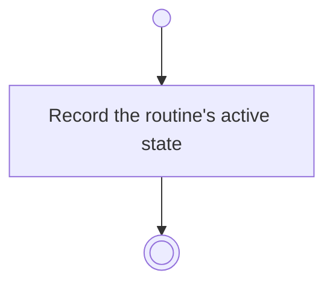

# BP03.04 — Pause or resume a routine

> GENERATED by `bpmn-dsl si-export` — do not edit; the source is the `call` block in the
> `.bpd` (#1182/ADR-068, keyed by call site per ADR-069).
>
> hash: `sha256:9c428cd9e2b0d6abee60ee505616fb36888f69ee584b6f21778e4cb597b5a207`

## BP03_MaintainRoutines — Activity diagram

### Bound rules

| Where | Rule |
|---|---|
| Record the routine's active state | `BR-43` |

### Messages

| Where | Message | To | Payload |
|---|---|---|---|
| Pause or resume a routine | Active state recorded | User | — |

### Notes

- **Pause or resume a routine**: One request covers both directions. A paused routine leaves the focus selectables and the due computation, and returns to both on resume.
