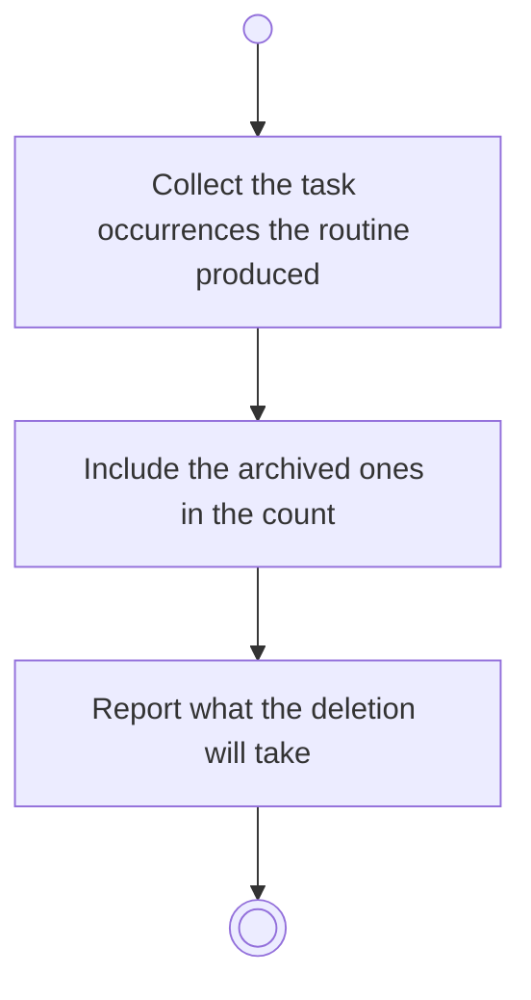

# BP03.06 — See what deleting a routine takes

> GENERATED by `bpmn-dsl si-export` — do not edit; the source is the `call` block in the
> `.bpd` (#1182/ADR-068, keyed by call site per ADR-069).
>
> hash: `sha256:39a55bf2a9802d4ab5e80146794f277bf06981270fd56237df9afcce9f32be05`

## BP03_MaintainRoutines — Activity diagram

### Bound rules

| Where | Rule |
|---|---|
| Include the archived ones in the count | `BR-117` |
| Report what the deletion will take | `BR-19` |

### Messages

| Where | Message | To | Payload |
|---|---|---|---|
| See what deleting a routine takes | What the deletion will take | User | — |

### Notes

- **See what deleting a routine takes**: The occurrences are a declinable cascade, so it starts off. Declining leaves them on Chores and stops the routine producing new ones.
