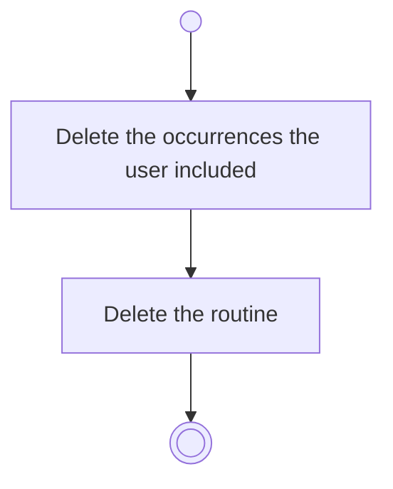

# BP03.07 — Delete a routine

> GENERATED by `bpmn-dsl si-export` — do not edit; the source is the `call` block in the
> `.bpd` (#1182/ADR-068, keyed by call site per ADR-069).
>
> hash: `sha256:5e7330885517b62ef4ab77a2ca5c20dcb81dd46179601b05601030f4887cbabd`

## BP03_MaintainRoutines — Activity diagram

### Bound rules

| Where | Rule |
|---|---|
| Delete the occurrences the user included | `BR-16` |

### Messages

| Where | Message | To | Payload |
|---|---|---|---|
| Delete a routine | Routine deleted | User | — |

### Notes

- **Delete a routine**: The request carries the cascade the user approved.
