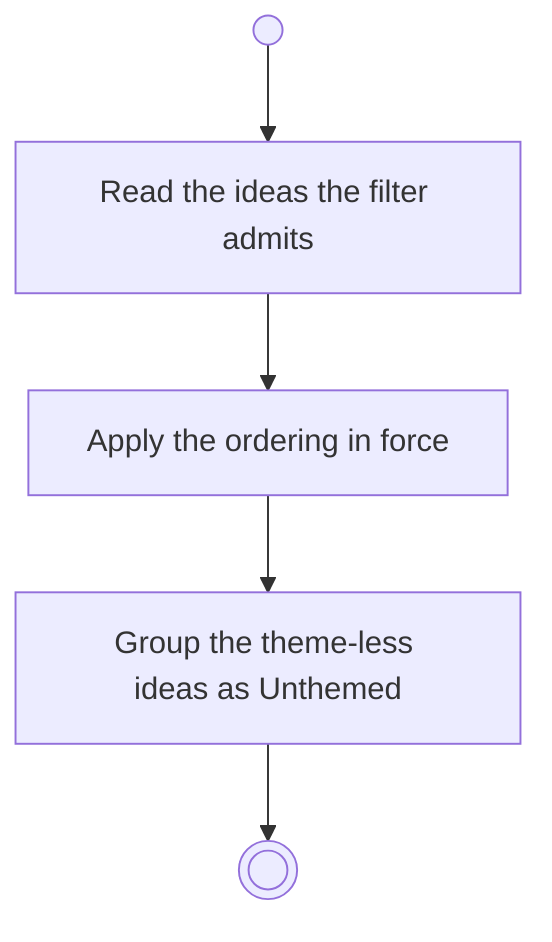

# BP04.01 — Read the ideation overview

> GENERATED by `bpmn-dsl si-export` — do not edit; the source is the `call` block in the
> `.bpd` (#1182/ADR-068, keyed by call site per ADR-069).
>
> hash: `sha256:a286744a2e788adc843ead73ad86f314c0103fea72bbd4250c0edbe6270b795e`

## BP04_CaptureAndCurateIdeas — Activity diagram

### Bound rules

| Where | Rule |
|---|---|
| Apply the ordering in force | `BR-88` |
| Group the theme-less ideas as Unthemed | `BR-03` |

### Messages

| Where | Message | To | Payload |
|---|---|---|---|
| Read the ideation overview | Ideas, filtered and sorted | User | — |

### Notes

- **Read the ideation overview**: Archived ideas are not in the working view.
