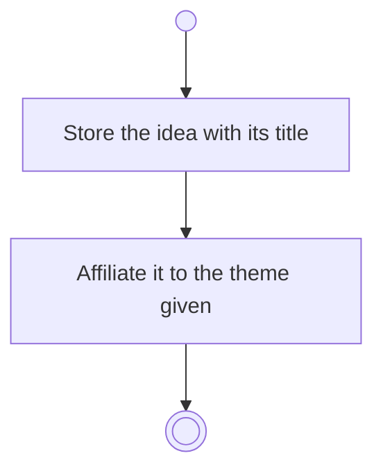

# BP04.02 — Capture an idea

> GENERATED by `bpmn-dsl si-export` — do not edit; the source is the `call` block in the
> `.bpd` (#1182/ADR-068, keyed by call site per ADR-069).
>
> hash: `sha256:fb0a0412146cfd4f682c5d84eedddc5e4dc72fef9dd5a083fda616f75f14d556`

## BP04_CaptureAndCurateIdeas — Activity diagram

### Bound rules

| Where | Rule |
|---|---|
| Affiliate it to the theme given | `BR-03` |

### Messages

| Where | Message | To | Payload |
|---|---|---|---|
| Capture an idea | Idea captured | User | — |

### Notes

- **Capture an idea**: The theme may be absent.
