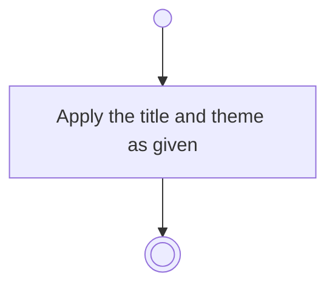

# BP04.03 — Amend an idea

> GENERATED by `bpmn-dsl si-export` — do not edit; the source is the `call` block in the
> `.bpd` (#1182/ADR-068, keyed by call site per ADR-069).
>
> hash: `sha256:0d678556db98d00cfc2bc61c1bbc2214c16ee41e44bd1c8f5ecd405cfa1f018d`

## BP04_CaptureAndCurateIdeas — Activity diagram

### Bound rules

| Where | Rule |
|---|---|
| Apply the title and theme as given | `BR-05` |

### Messages

| Where | Message | To | Payload |
|---|---|---|---|
| Amend an idea | Idea amended | User | — |

### Notes

- **Amend an idea**: An archived idea is not editable.
