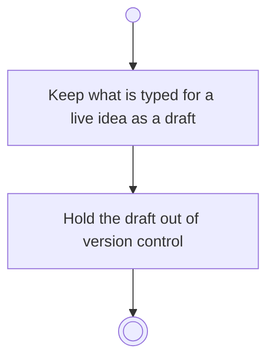

# BP04.04 — Draft the idea input

> GENERATED by `bpmn-dsl si-export` — do not edit; the source is the `call` block in the
> `.bpd` (#1182/ADR-068, keyed by call site per ADR-069).
>
> hash: `sha256:ab41407e58128fdca16e844b53c3c3a617f479ca15b4109c9bf3984a1cd2327b`

## BP04_CaptureAndCurateIdeas — Activity diagram

### Bound rules

| Where | Rule |
|---|---|
| Keep what is typed for a live idea as a draft | `BR-05` |
| Hold the draft out of version control | `BR-121` |

### Notes

- **Draft the idea input**: Every form on this surface drafts as it is filled in — the capture form, the title and theme, and the notes as they are written. The draft is one-way: nothing waits for it to be kept, it changes nothing on the idea, and whichever write commits the form discards it.
