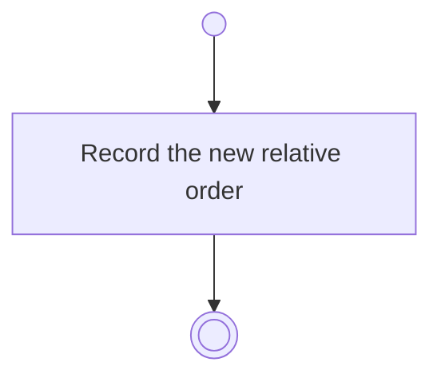

# BP04.05 — Reorder ideas

> GENERATED by `bpmn-dsl si-export` — do not edit; the source is the `call` block in the
> `.bpd` (#1182/ADR-068, keyed by call site per ADR-069).
>
> hash: `sha256:8e28abf097da48705662bcf56caa0ae1dcd3e8d78b9110bdf9cba62924a7897e`

## BP04_CaptureAndCurateIdeas — Activity diagram

### Messages

| Where | Message | To | Payload |
|---|---|---|---|
| Reorder ideas | Order recorded | User | — |
