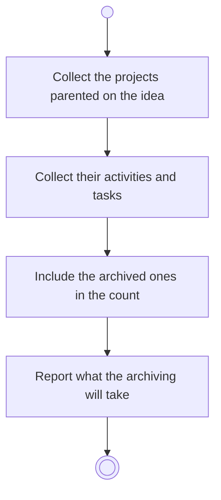

# BP04.06 — See what archiving an idea takes

> GENERATED by `bpmn-dsl si-export` — do not edit; the source is the `call` block in the
> `.bpd` (#1182/ADR-068, keyed by call site per ADR-069).
>
> hash: `sha256:cc10c8b71801e16e2eb9b5312c5effe8b830e14d5a3bf83eeb1a8ded085a0561`

## BP04_CaptureAndCurateIdeas — Activity diagram

### Bound rules

| Where | Rule |
|---|---|
| Include the archived ones in the count | `BR-117` |
| Report what the archiving will take | `BR-112` |

### Messages

| Where | Message | To | Payload |
|---|---|---|---|
| See what archiving an idea takes | What the archiving will take | User | — |

### Notes

- **See what archiving an idea takes**: Nothing below a project can be left behind, so the gesture is approve-or-abandon.
