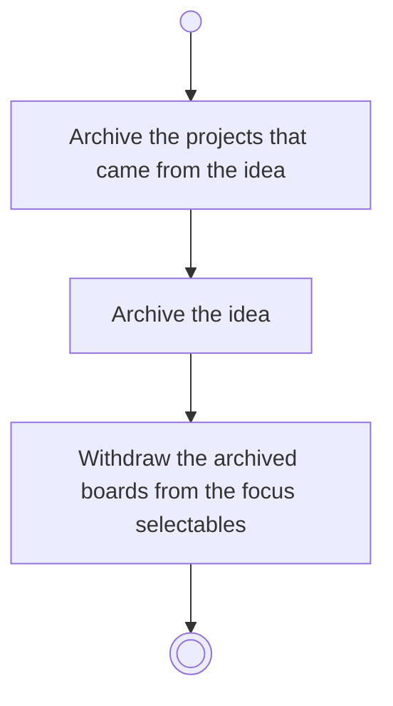

# BP04.07 — Archive an idea

> GENERATED by `bpmn-dsl si-export` — do not edit; the source is the `call` block in the
> `.bpd` (#1182/ADR-068, keyed by call site per ADR-069).
>
> hash: `sha256:f2224e64e62a763cb18a1caca31a92e55100642ffc313484260496fcba4c0f67`

## BP04_CaptureAndCurateIdeas — Activity diagram

### Bound rules

| Where | Rule |
|---|---|
| Archive the projects that came from the idea | `BR-112` |
| Withdraw the archived boards from the focus selectables | `BR-43` |

### Messages

| Where | Message | To | Payload |
|---|---|---|---|
| Archive an idea | Idea archived | User | — |

### Notes

- **Archive an idea**: Unarchiving restores the whole bundle.
