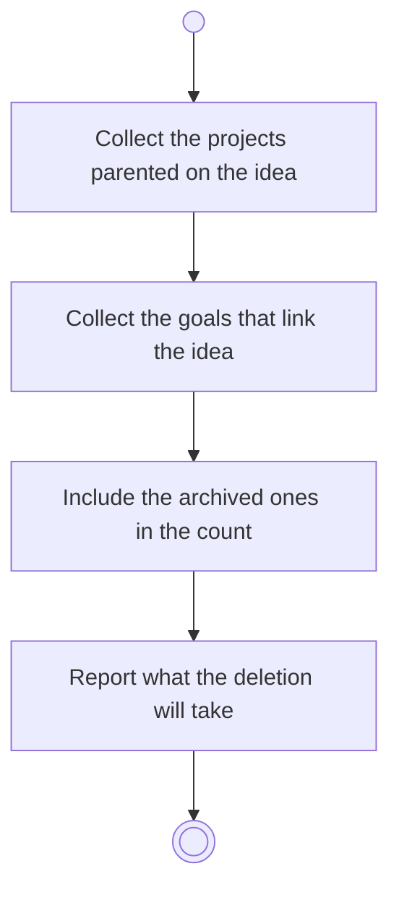

# BP04.08 — See what deleting an idea takes

> GENERATED by `bpmn-dsl si-export` — do not edit; the source is the `call` block in the
> `.bpd` (#1182/ADR-068, keyed by call site per ADR-069).
>
> hash: `sha256:13741263b983456f85c2163bd1b6507fbca7dad6699ff57921cd096f0fa99d64`

## BP04_CaptureAndCurateIdeas — Activity diagram

### Bound rules

| Where | Rule |
|---|---|
| Include the archived ones in the count | `BR-117` |
| Report what the deletion will take | `BR-14` |

### Messages

| Where | Message | To | Payload |
|---|---|---|---|
| See what deleting an idea takes | What the deletion will take | User | — |

### Notes

- **See what deleting an idea takes**: Keeping a project behind is not offered. A goal that links the idea survives minus the link.
