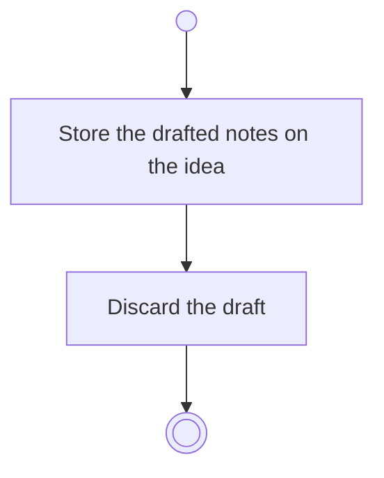

# BP04.10 — Commit the idea notes

> GENERATED by `bpmn-dsl si-export` — do not edit; the source is the `call` block in the
> `.bpd` (#1182/ADR-068, keyed by call site per ADR-069).
>
> hash: `sha256:e6ff87a20a223ab63e761bfceeb895e4417fbacdf1c59fb70df269b94b235b66`

## BP04_CaptureAndCurateIdeas — Activity diagram

### Bound rules

| Where | Rule |
|---|---|
| Store the drafted notes on the idea | `BR-05` |
| Discard the draft | `BR-121` |

### Messages

| Where | Message | To | Payload |
|---|---|---|---|
| Commit the idea notes | Notes committed | User | — |

### Notes

- **Commit the idea notes**: The commit is what enters the planning history, and the draft is dropped once it is in.
