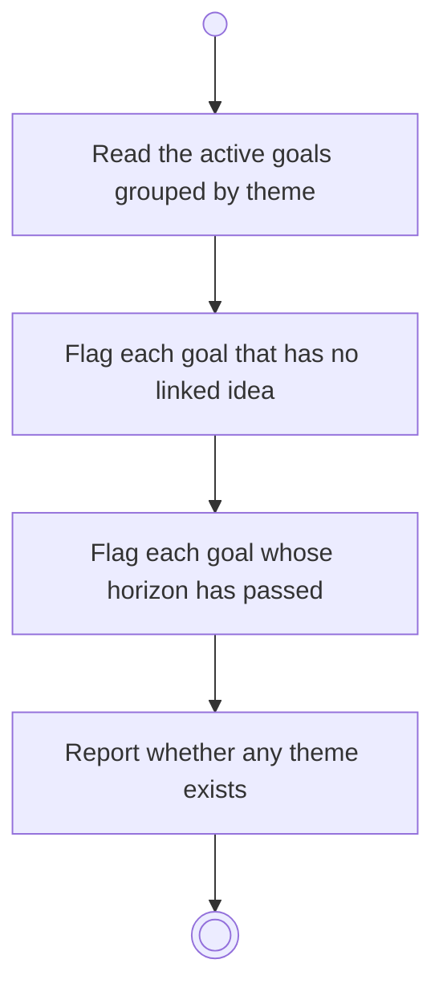

# BP05.01 — Read the goals overview

> GENERATED by `bpmn-dsl si-export` — do not edit; the source is the `call` block in the
> `.bpd` (#1182/ADR-068, keyed by call site per ADR-069).
>
> hash: `sha256:5907c38e5618dbcea662e88408370a64524c27ce8eabcb695ac4a6150c7deaaf`

## BP05_CommitToAndMaintainAGoal — Activity diagram

### Bound rules

| Where | Rule |
|---|---|
| Read the active goals grouped by theme | `BR-87` |
| Flag each goal that has no linked idea | `BR-04` |
| Flag each goal whose horizon has passed | `BR-22` |
| Report whether any theme exists | `BR-84` |

### Messages

| Where | Message | To | Payload |
|---|---|---|---|
| Read the goals overview | Goals grouped by theme | User | — |

### Notes

- **Read the goals overview**: The flags read the current state. Nothing acts on the goal.
