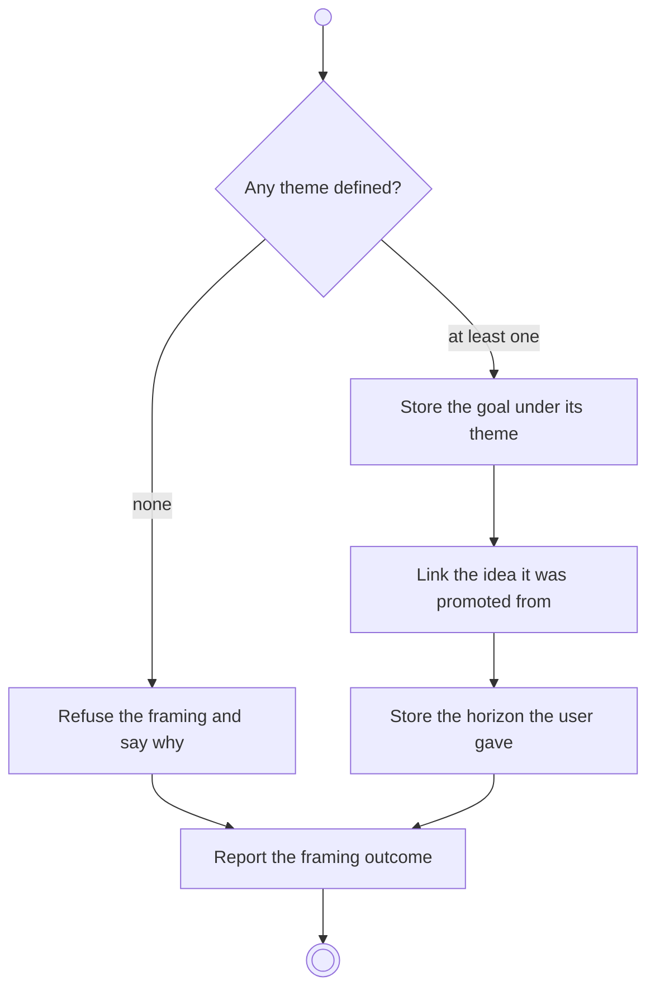

# BP05.02 — Frame a goal

> GENERATED by `bpmn-dsl si-export` — do not edit; the source is the `call` block in the
> `.bpd` (#1182/ADR-068, keyed by call site per ADR-069).
>
> hash: `sha256:f839036423521294f14ad768d90d81da21169b8c20b07d93b91421d0a51d76fe`

## BP05_CommitToAndMaintainAGoal — Activity diagram

### Bound rules

| Where | Rule |
|---|---|
| "Any theme defined?" | `BR-84` |
| Store the goal under its theme | `BR-01` |
| Link the idea it was promoted from | `BR-04` |

### Messages

| Where | Message | To | Payload |
|---|---|---|---|
| Frame a goal | Framing outcome | User | — |

### Notes

- **Frame a goal**: One request frames a theme-only goal and promotes an idea alike. The horizon may be absent.
