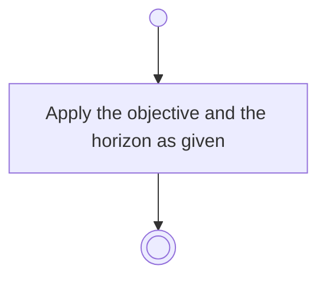

# BP05.03 — Amend a goal

> GENERATED by `bpmn-dsl si-export` — do not edit; the source is the `call` block in the
> `.bpd` (#1182/ADR-068, keyed by call site per ADR-069).
>
> hash: `sha256:325f003a20427a99098b4f18a4e0b1adc66ebf968f22cff19f2ab5fe14a641a7`

## BP05_CommitToAndMaintainAGoal — Activity diagram

### Bound rules

| Where | Rule |
|---|---|
| Apply the objective and the horizon as given | `BR-08` |

### Messages

| Where | Message | To | Payload |
|---|---|---|---|
| Amend a goal | Goal amended | User | — |

### Notes

- **Amend a goal**: A goal has no parent and no children.
