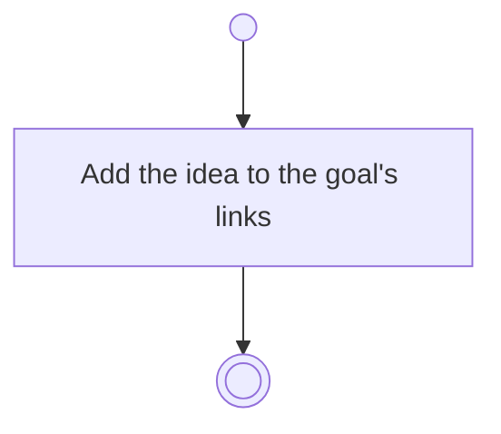

# BP05.04 — Link an idea to a goal

> GENERATED by `bpmn-dsl si-export` — do not edit; the source is the `call` block in the
> `.bpd` (#1182/ADR-068, keyed by call site per ADR-069).
>
> hash: `sha256:a046c8a98399f62158678eccd19b2fb6be35d66a376faf415118a982f49eeb7a`

## BP05_CommitToAndMaintainAGoal — Activity diagram

### Bound rules

| Where | Rule |
|---|---|
| Add the idea to the goal's links | `BR-04` |

### Messages

| Where | Message | To | Payload |
|---|---|---|---|
| Link an idea to a goal | Idea linked | User | — |
