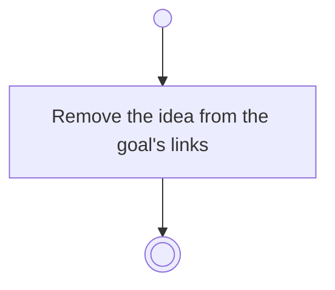

# BP05.05 — Unlink an idea from a goal

> GENERATED by `bpmn-dsl si-export` — do not edit; the source is the `call` block in the
> `.bpd` (#1182/ADR-068, keyed by call site per ADR-069).
>
> hash: `sha256:97df1e98654cda4c0bde0c350c85eb24ef31034083ff20c949d6d25a1d8d6b6a`

## BP05_CommitToAndMaintainAGoal — Activity diagram

### Bound rules

| Where | Rule |
|---|---|
| Remove the idea from the goal's links | `BR-04` |

### Messages

| Where | Message | To | Payload |
|---|---|---|---|
| Unlink an idea from a goal | Idea unlinked | User | — |
