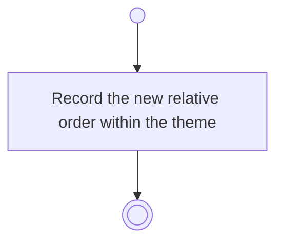

# BP05.11 — Reorder goals within a theme

> GENERATED by `bpmn-dsl si-export` — do not edit; the source is the `call` block in the
> `.bpd` (#1182/ADR-068, keyed by call site per ADR-069).
>
> hash: `sha256:8e005cf7e3d6cc7ff0ed36ce2b39b3aae3a0f237fe42982f59d796f0779bc87a`

## BP05_CommitToAndMaintainAGoal — Activity diagram

### Messages

| Where | Message | To | Payload |
|---|---|---|---|
| Reorder goals within a theme | Order recorded | User | — |
