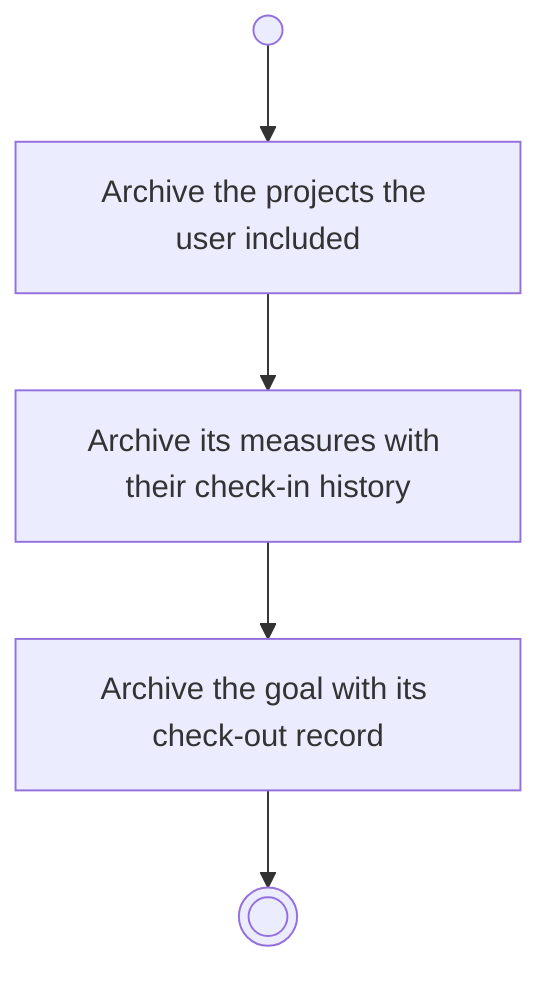

# BP05.13 — Archive a goal

> GENERATED by `bpmn-dsl si-export` — do not edit; the source is the `call` block in the
> `.bpd` (#1182/ADR-068, keyed by call site per ADR-069).
>
> hash: `sha256:7e84599aa0d2ffc068ccbceabff092759fd4f038c2557beb31c76cfd10e39136`

## BP05_CommitToAndMaintainAGoal — Activity diagram

### Bound rules

| Where | Rule |
|---|---|
| Archive the projects the user included | `BR-112` |
| Archive its measures with their check-in history | `BR-112` |
| Archive the goal with its check-out record | `BR-23` |

### Messages

| Where | Message | To | Payload |
|---|---|---|---|
| Archive a goal | Goal archived | User | — |

### Notes

- **Archive a goal**: Archiving is independent of closing out. A check-out record already attached stays with the goal.
