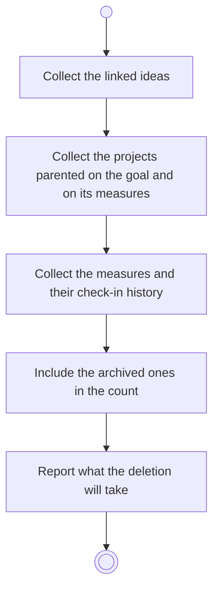

# BP05.14 — See what deleting a goal takes

> GENERATED by `bpmn-dsl si-export` — do not edit; the source is the `call` block in the
> `.bpd` (#1182/ADR-068, keyed by call site per ADR-069).
>
> hash: `sha256:1197add37ddd467e5672200d41e76225a24791fedf686e1d0a6989af9b6e965f`

## BP05_CommitToAndMaintainAGoal — Activity diagram

### Bound rules

| Where | Rule |
|---|---|
| Include the archived ones in the count | `BR-117` |
| Report what the deletion will take | `BR-15` |

### Messages

| Where | Message | To | Payload |
|---|---|---|---|
| See what deleting a goal takes | What the deletion will take | User | — |

### Notes

- **See what deleting a goal takes**: The measures and their history go unasked. Keeping a project behind is not offered.
