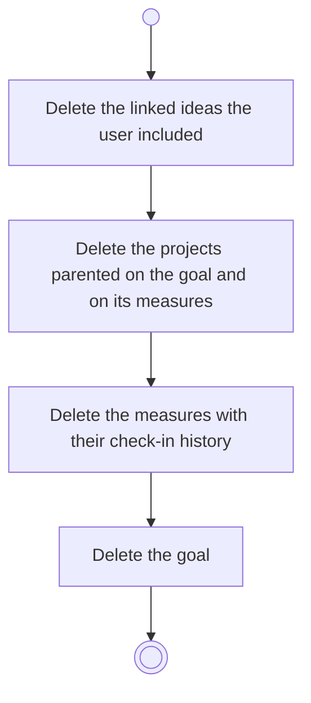

# BP05.15 — Delete a goal

> GENERATED by `bpmn-dsl si-export` — do not edit; the source is the `call` block in the
> `.bpd` (#1182/ADR-068, keyed by call site per ADR-069).
>
> hash: `sha256:8aa14f7d9a0b8d7906898faf193ca6b62c352d5508a7a7885dc564bb93c8ca2d`

## BP05_CommitToAndMaintainAGoal — Activity diagram

### Bound rules

| Where | Rule |
|---|---|
| Delete the linked ideas the user included | `BR-15` |

### Messages

| Where | Message | To | Payload |
|---|---|---|---|
| Delete a goal | Goal deleted | User | — |
