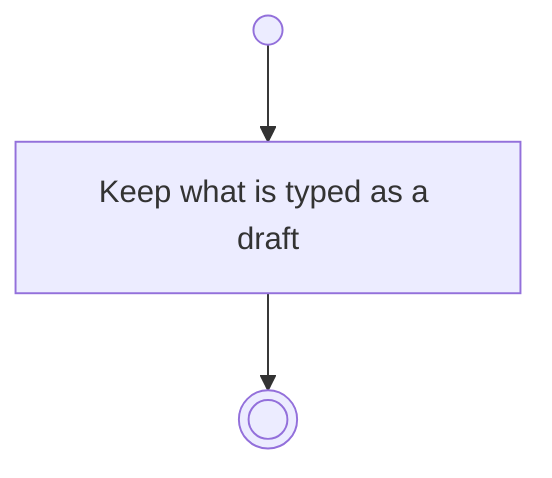

# BP05.16 — Draft the goal input

> GENERATED by `bpmn-dsl si-export` — do not edit; the source is the `call` block in the
> `.bpd` (#1182/ADR-068, keyed by call site per ADR-069).
>
> hash: `sha256:a08bc68f34640803e2cfd086f4192d6cb7fdb9c4988e458540e68033dd4d3a5d`

## BP05_CommitToAndMaintainAGoal — Activity diagram

### Bound rules

| Where | Rule |
|---|---|
| Keep what is typed as a draft | `BR-121` |

### Notes

- **Draft the goal input**: Every form on this surface drafts as it is filled in, so leaving it half-finished, a crash and a restart all cost nothing. The draft is one-way: nothing waits for it to be kept. Whichever write commits the form discards it.
