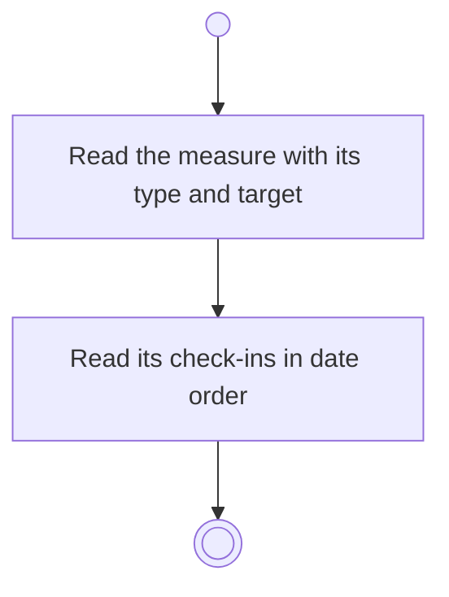

# BP06.01 — Read a measure's check-in history

> GENERATED by `bpmn-dsl si-export` — do not edit; the source is the `call` block in the
> `.bpd` (#1182/ADR-068, keyed by call site per ADR-069).
>
> hash: `sha256:dad34abf7bbf5c40a7bd28c13ece4d34aa92121bbc73d8a6a0866a3df2b882b6`

## BP06_MeasureGoalProgress — Activity diagram

### Messages

| Where | Message | To | Payload |
|---|---|---|---|
| Read a measure's check-in history | The measure's check-ins over time | User | — |

### Notes

- **Read a measure's check-in history**: The history hangs on the measure's identity, so reordering the measures never disturbs it. The goal is known to be live by now: the freeze is answered at the entry.
