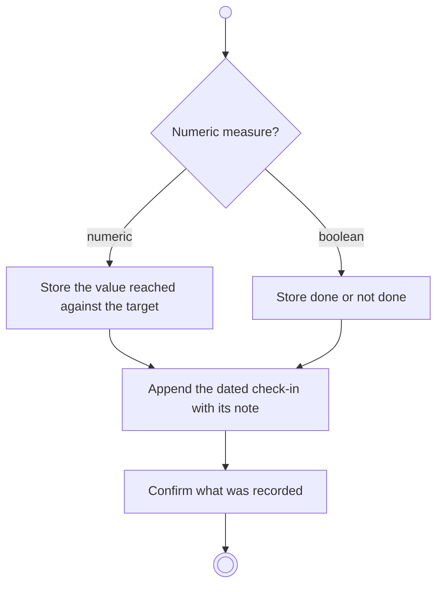

# BP06.02 — Record a progress check-in

> GENERATED by `bpmn-dsl si-export` — do not edit; the source is the `call` block in the
> `.bpd` (#1182/ADR-068, keyed by call site per ADR-069).
>
> hash: `sha256:20bc99d1bf1dfd95780475964b6735edbe868b9e470497621ea56d4fa9aa9232`

## BP06_MeasureGoalProgress — Activity diagram

### Bound rules

| Where | Rule |
|---|---|
| "Numeric measure?" | `BR-28` |

### Messages

| Where | Message | To | Payload |
|---|---|---|---|
| Record a progress check-in | Check-in recorded | User | — |

### Notes

- **Record a progress check-in**: The history is append-only, so a date that already carries a check-in takes another and each is its own data point. A check-in records a data point and infers no status.
