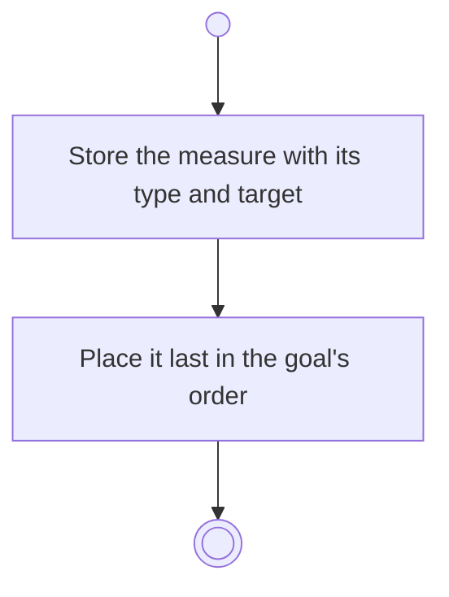

# BP06.03 — Add a progress measure

> GENERATED by `bpmn-dsl si-export` — do not edit; the source is the `call` block in the
> `.bpd` (#1182/ADR-068, keyed by call site per ADR-069).
>
> hash: `sha256:fab5f04dd4e2d9f8f11d6637941b80bebb73197b6153ecfb8218e66db0e36d3a`

## BP06_MeasureGoalProgress — Activity diagram

### Bound rules

| Where | Rule |
|---|---|
| Store the measure with its type and target | `BR-28` |

### Messages

| Where | Message | To | Payload |
|---|---|---|---|
| Add a progress measure | Measure added | User | — |

### Notes

- **Add a progress measure**: There is no untyped measure.
