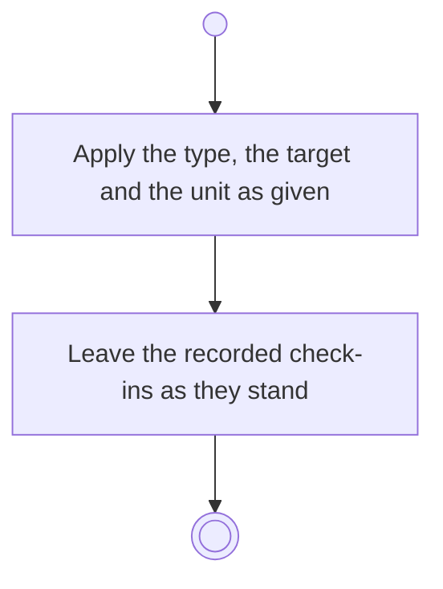

# BP06.04 — Amend a progress measure

> GENERATED by `bpmn-dsl si-export` — do not edit; the source is the `call` block in the
> `.bpd` (#1182/ADR-068, keyed by call site per ADR-069).
>
> hash: `sha256:700657021fd1671c15ae114cc102e35a8fffaf9171d70882223bf50877735500`

## BP06_MeasureGoalProgress — Activity diagram

### Bound rules

| Where | Rule |
|---|---|
| Apply the type, the target and the unit as given | `BR-28` |

### Messages

| Where | Message | To | Payload |
|---|---|---|---|
| Amend a progress measure | Measure amended | User | — |

### Notes

- **Amend a progress measure**: The type is amendable like the target and the unit. Each check-in keeps the type it was recorded under, so the history is never rewritten.
