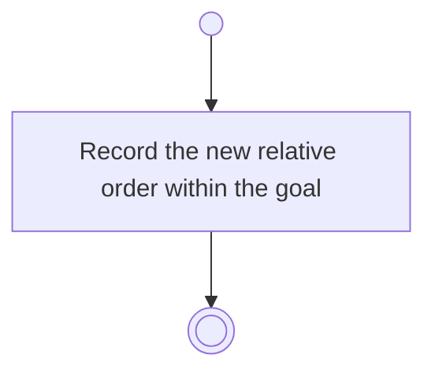

# BP06.05 — Reorder progress measures

> GENERATED by `bpmn-dsl si-export` — do not edit; the source is the `call` block in the
> `.bpd` (#1182/ADR-068, keyed by call site per ADR-069).
>
> hash: `sha256:d83f070160bb691a31382d9a27befe938c3588d05fa98cfd5907f7711fc18da7`

## BP06_MeasureGoalProgress — Activity diagram

### Messages

| Where | Message | To | Payload |
|---|---|---|---|
| Reorder progress measures | Order recorded | User | — |
