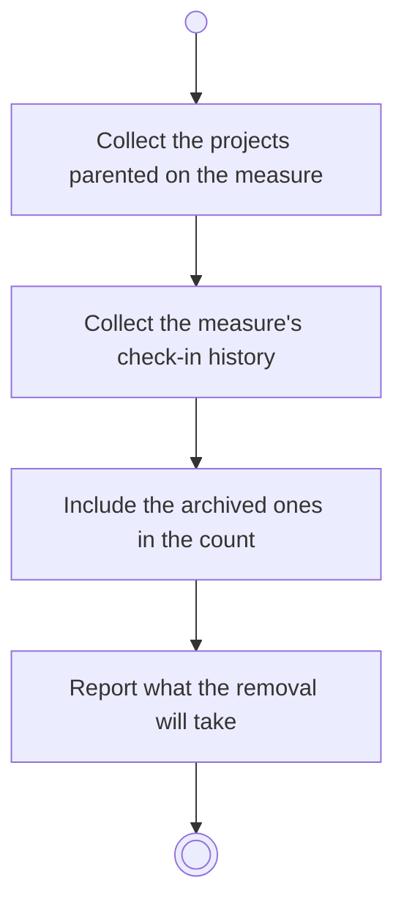

# BP06.06 — See what removing a measure takes

> GENERATED by `bpmn-dsl si-export` — do not edit; the source is the `call` block in the
> `.bpd` (#1182/ADR-068, keyed by call site per ADR-069).
>
> hash: `sha256:36575554b7209d48482086668be15c97b0d5369dfb16bcd39c5ddaa052d624c7`

## BP06_MeasureGoalProgress — Activity diagram

### Bound rules

| Where | Rule |
|---|---|
| Include the archived ones in the count | `BR-117` |
| Report what the removal will take | `BR-115` |

### Messages

| Where | Message | To | Payload |
|---|---|---|---|
| See what removing a measure takes | What the removal will take | User | — |

### Notes

- **See what removing a measure takes**: The check-in history goes unasked. The projects are a cascade the user approves or abandons.
