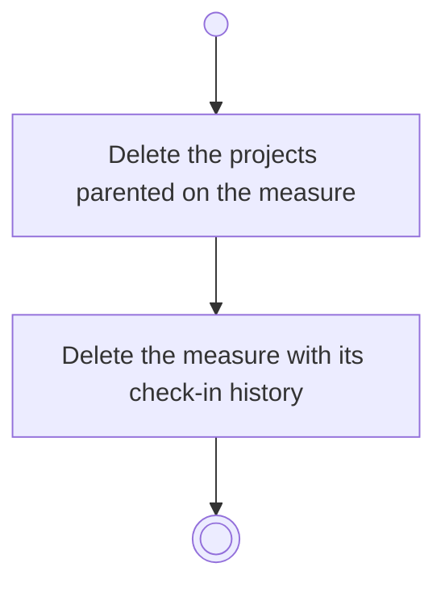

# BP06.07 — Remove a progress measure

> GENERATED by `bpmn-dsl si-export` — do not edit; the source is the `call` block in the
> `.bpd` (#1182/ADR-068, keyed by call site per ADR-069).
>
> hash: `sha256:8773e891b7aade59bc055b7a723f702f5cea3ae370a618594c2d8f5cde394bc5`

## BP06_MeasureGoalProgress — Activity diagram

### Bound rules

| Where | Rule |
|---|---|
| Delete the projects parented on the measure | `BR-115` |

### Messages

| Where | Message | To | Payload |
|---|---|---|---|
| Remove a progress measure | Measure removed | User | — |
