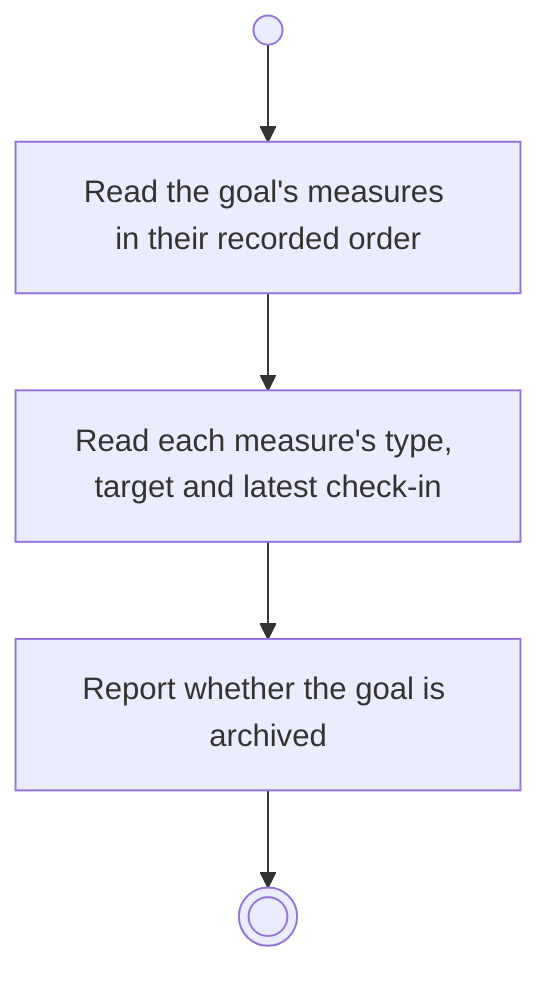

# BP06.08 — Read the goal's progress measures

> GENERATED by `bpmn-dsl si-export` — do not edit; the source is the `call` block in the
> `.bpd` (#1182/ADR-068, keyed by call site per ADR-069).
>
> hash: `sha256:606595f144a73df98f5450dc0bd280f908f70922b463e39a10f1e7521cafd0c0`

## BP06_MeasureGoalProgress — Activity diagram

### Bound rules

| Where | Rule |
|---|---|
| Read each measure's type, target and latest check-in | `BR-28` |
| Report whether the goal is archived | `BR-05` |

### Messages

| Where | Message | To | Payload |
|---|---|---|---|
| Read the goal's progress measures | The measures with their types and targets | User | — |

### Notes

- **Read the goal's progress measures**: The goals overview carries no measures, so this is where they are read. An archived goal is reported as such, and nothing here can change while it is.
