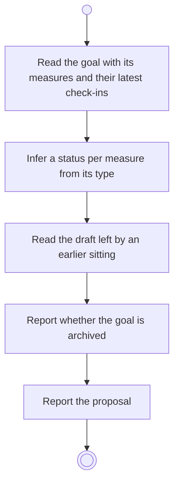

# BP07.01 — Read the goal's check-out proposal

> GENERATED by `bpmn-dsl si-export` — do not edit; the source is the `call` block in the
> `.bpd` (#1182/ADR-068, keyed by call site per ADR-069).
>
> hash: `sha256:e344596fcb0f5f6c5d46e1a4d6187583627b0bd63cf3678905d6b03d242e0886`

## BP07_CloseOutAGoal — Activity diagram

### Bound rules

| Where | Rule |
|---|---|
| Infer a status per measure from its type | `BR-28` |
| Read the draft left by an earlier sitting | `BR-32` |
| Report whether the goal is archived | `BR-05` |
| Report the proposal | `BR-39` |

### Messages

| Where | Message | To | Payload |
|---|---|---|---|
| Read the goal's check-out proposal | The proposal with a status per measure | User | — |

### Notes

- **Read the goal's check-out proposal**: The proposal is what the system observed: the statuses are inferred, not decided. A check-out is available at any time, with or without a horizon, as long as the goal is not archived.
